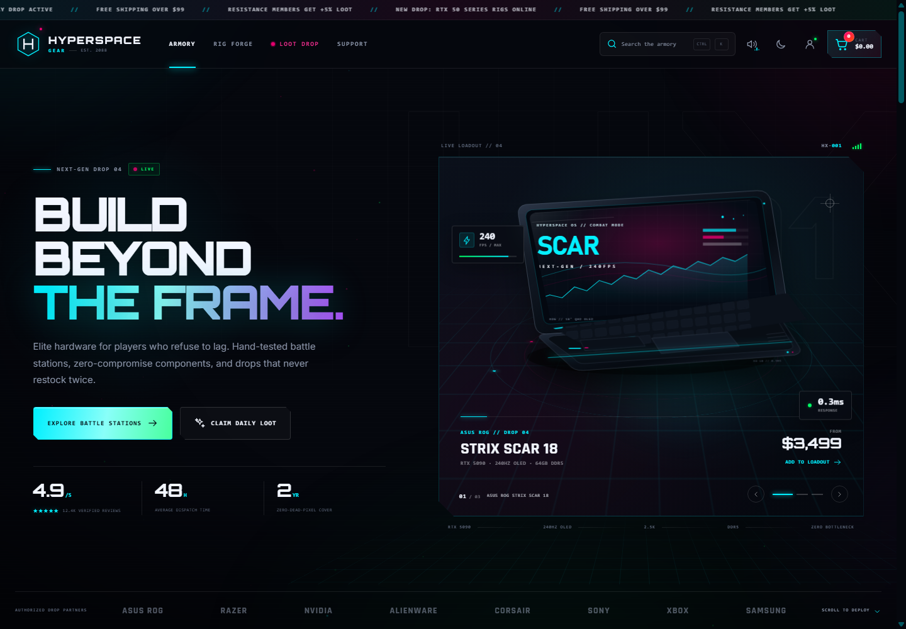
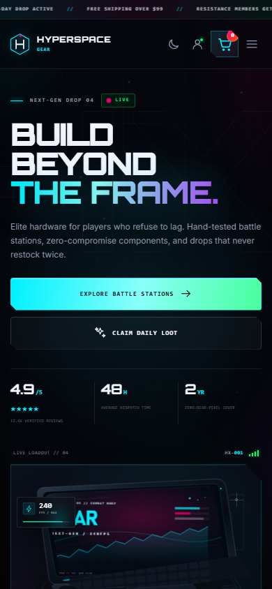
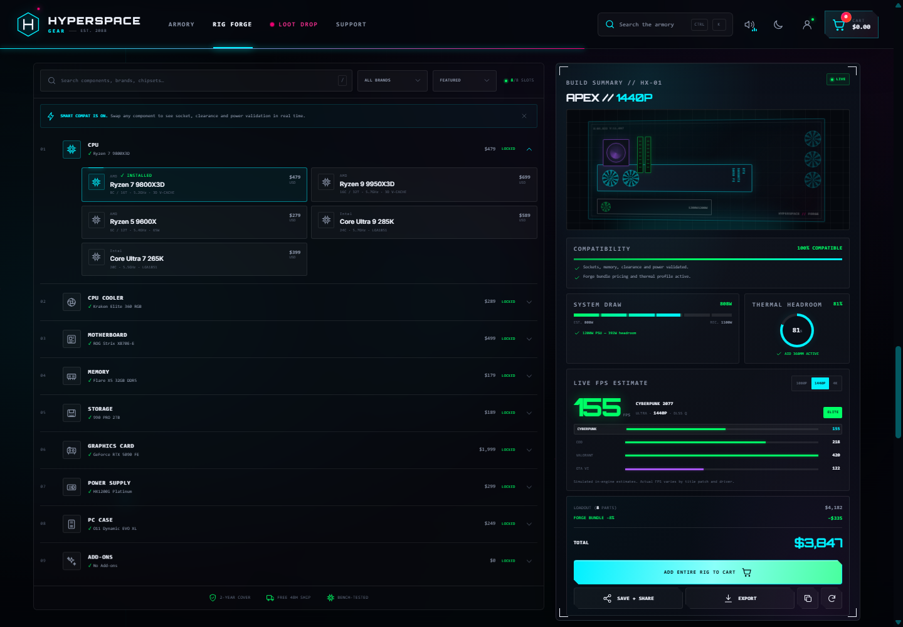

# NEO GAMING

A fully responsive, dependency-free gaming-commerce storefront and interactive rig forge. Built as a static single-page application with hand-drawn SVG product art, Web Audio micro-interactions, and local persistence.



| Mobile | Rig Forge |
| --- | --- |
|  |  |

## Run it

```bash
npm run dev
```

Open `http://127.0.0.1:4173`.

No install step is required — the project uses only the browser platform and Node's built-in HTTP server.

## What is included

- Sticky glass HUD navigation with animated logo, synthesized sound toggle, global `Ctrl/Cmd + K` search autocomplete, theme switch, operator portal, and RGB-glow cart badge.
- Autoplaying hero product stage with three drops, performance chips, quick-add and readout controls.
- Five-sector category explorer, live product filtering, price ceiling, sorting and product quick-look modal.
- Product cards with generated hardware illustrations, hover scanlines, wishlist persistence, stock urgency, spec tags, and micro-confetti quick-add.
- Full cart drawer with quantities, free-shipping meter, promo codes, totals, and checkout simulation.
- **RIG FORGE:** nine component categories, quick-deploy presets, part search and brand filter, live pricing, wattage estimation, PSU headroom validation, socket/RAM/clearance compatibility checks, thermal headroom, resolution and game-specific FPS estimates, shareable build URLs, CSV export and print/PDF layout.
- Flash-drop countdown, loot progress, daily crate reward, newsletter dispatch, support terminal, and footer system status.
- Dark void and RGB-light themes, local browser persistence, keyboard navigation, focus trapping, reduced-motion support and ARIA labels.

## Promo codes

| Code | Reward |
| --- | --- |
| `NEO-DAILY-20` | 20% off (also awarded by the Daily Loot crate) |
| `NOVA10` | 10% off |
| `RESISTANCE5` | 5% off |

## Project structure

```text
index.html      App shell, navigation, sections, overlays
styles.css      Design system, HUD layout, responsive rules, motion
data.js         Product catalog, rig parts, game presets, promo codes
art.js          Generated SVG hardware illustrations
app.js          Cart, search, builder engine, overlays, interactions
server.js       Zero-dependency static server
```

All data is local and fictional. No real payment is processed.
